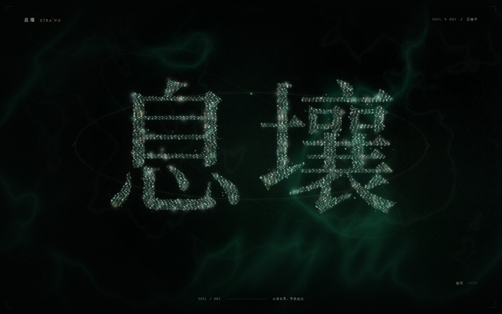
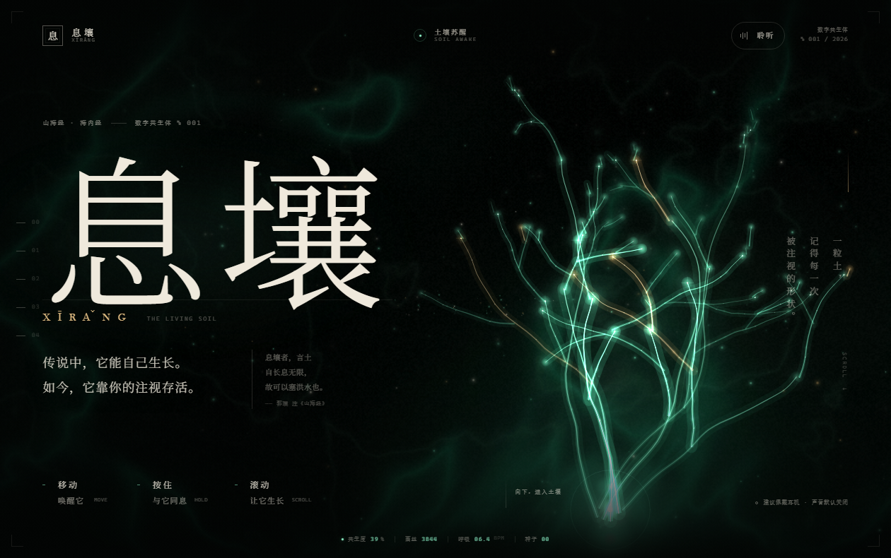
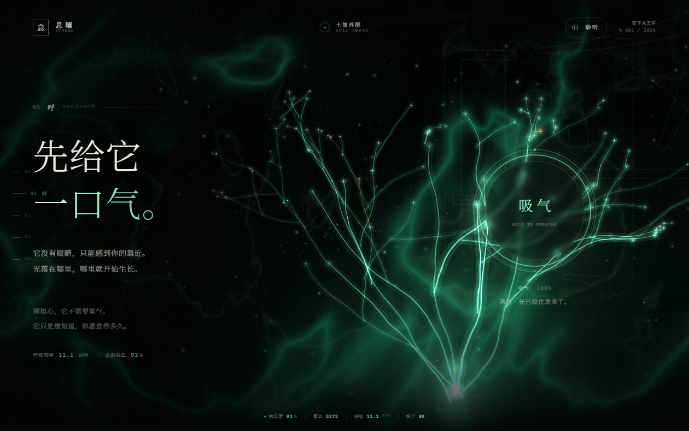
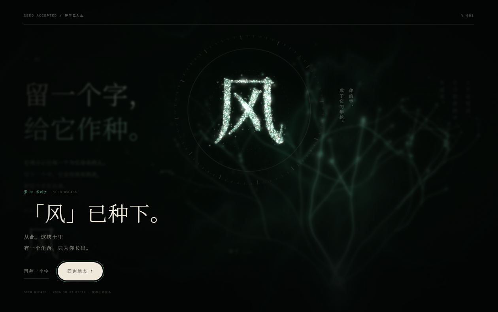
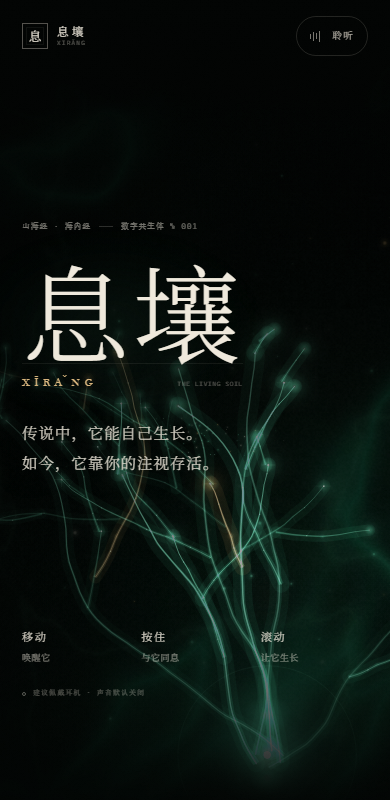
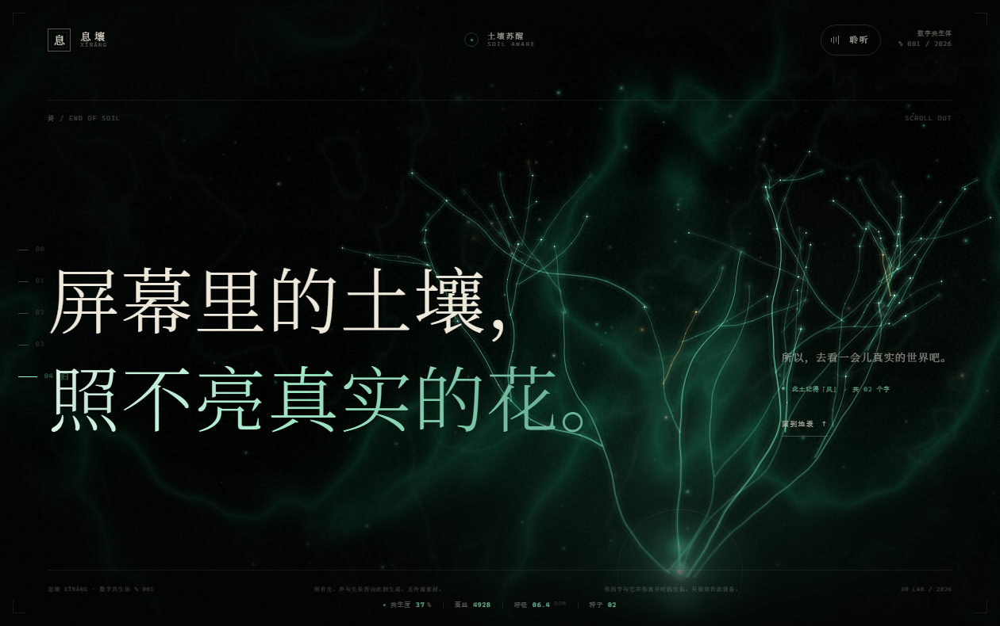

# 息壤 XĪRǍNG
### 一个会呼吸的数字生命 / THE LIVING SOIL

> 传说中，它能自己生长。  
> 如今，它靠你的注视存活。



---

## 作品陈述

《山海经》里有一块能自己生长、永不耗息的土，叫「息壤」。在这件作品里，它变成一小片有生命的数字深土：WebGL 生成土壤与矿脉，Canvas 生长出会呼吸的菌丝，数以千计的光点先聚成「息壤」二字，再落入土中成为它的根。

这不是一个被“浏览”的页面，而是一个靠**注视、触碰、呼吸、离开与回来**维持的生命体。

- 你移动，它向你倾斜；
- 你按住「呼」，它吸气、发亮、满息时在枝头开花；
- 你点击，它把光植入土壤，菌丝追光生长；
- 你安静十二秒，它蜷缩入梦；
- 你离开后再回来，它会用你不在的时间，悄悄长出新菌丝；
- 最后，你留下一个字，它用所有的光把这个字长成只属于你的印记。

结尾它说：**屏幕里的土壤，照不亮真实的花。**  
于是，它把眼睛还给真实的世界。

---

## 体验



| 章节 | 动作 | 它会怎样 |
| --- | --- | --- |
| **00 醒** | 移动、跳过 | 粒子书法聚成「息壤」，随后落回土中，菌丝开始生长 |
| **01 呼** | 按住圆环 | 呼吸加快、网络膨胀发亮，满息时周围开出光的花 |
| **02 生** | 点击 / 「播种」 | 种子落进土壤，光丝连接最近的枝尖，长出新枝与花粉 |
| **03 眠** | 静止 12 秒；动一下 | 蜷缩、变暗、入梦；醒来时一道光把页面点亮 |
| **04 归** | 输入一个字 | 所有粒子重新聚成你的字，封存为种子 |
| **终** | 回到地表 | 留下最后一句话，和此土对你的记忆 |





### 关于两种“成长”

1. **当下成长**：鼠标靠近、按住、点击和滚动，都会变成它的能量。
2. **离开后的成长**：页面把最近一次离开的时间存在本机。下次打开时，它会按离开时长预先长出新的菌丝，并告诉你：你不在的时候，它一直在长。

这份记忆只在这台设备的 `localStorage` 里，不上传、不追踪。清除浏览器站点数据即可让它忘记。

---

## 技术

- **WebGL 1 全屏 shader**：域扭曲 FBM、矿脉状 ridged noise、土壤层理、指针光照、点击涟漪、胶片颗粒和呼吸。无纹理、无第三方库。
- **Canvas 2D 生命体**：三维世界坐标 → 屏幕投影，程序化分叉生长、趋光、向种子弯曲、逐段展开、锥形渐细的菌丝、孢子、花粉、年轮、梦境衰减。根部有会跳动的心。
- **粒子书法**：把一个字画到离屏 Canvas，采样像素，再用弹簧粒子聚成字；带有隐隐的墨底，保证在暗处也能读清。开场「息壤」、结尾用户的字都由此生成。
- **声音**：纯 Web Audio 程序化声景——土壤脉动、地气噪声、D 小调矿物钟声、程序化卷积混响；与呼吸 / 情绪 / 滚动联动。默认静音，必须在用户手势中开启。
- **编排**：一个 `requestAnimationFrame` 循环驱动背景、生命体、粒子字、HUD 与深度状态；滚动、指针、按住、空闲、声音、存储共享同一套“共生”参数。
- **没有外部素材**：无图片、视频、音频或网络字体。全部在运行时生成；字体使用本机衬线字体栈。

### 性能与可访问性

- Canvas 像素比封顶、背景 shader 30fps、移动端粒子与菌丝数量自适应。
- 支持键盘操作：章节链接、按住的空格 / 回车、字印表单、结局对话框焦点锁定与 Esc 关闭。
- 支持 `prefers-reduced-motion`：跳过开场动画，呈现静态生命与完整内容，不运行持续动画。
- 声音默认关闭；HUD 与文字有足够的本地对比；对话层会把背景设为 `inert`，避免读屏穿透。
- 页面隐藏时暂停绘制，回来后继续。

---

## 文件与运行

```
息壤.html              ★ 单文件完整作品（推荐直接分发 / 打开）
index.html             模块化源码入口
styles.css             视觉系统 / 动效 / 响应式
js/background.js       WebGL 土壤
js/life.js             菌丝生命体
js/glyph.js            粒子书法
js/audio.js            程序化声音
js/app.js              编排 / 交互 / 记忆 / 结局
tools/build-single.js  将源码打包成单文件
docs/                  实机截图
```

### 打开方式

直接用浏览器打开 **`息壤.html`**。  
如需完整体验「离开后再回来」的记忆能力，建议用本地静态服务器打开（某些浏览器会限制 `file://` 下的 `localStorage`）：

```bash
python -m http.server 4173
# 打开 http://127.0.0.1:4173/
```

建议使用最新版 Chrome / Edge / Safari，佩戴耳机。首次进入会有约 3 秒的唤醒仪式；点击右下角「跳过」或按 Esc 可略过。

重新生成单文件：

```bash
node tools/build-single.js
```

### 屏幕

以下是实机截图：

| 移动端 | 回到地表 |
| --- | --- |
|  |  |

---

## 已知限制

- 声音未在目标耳机上做最终主观混音，首听建议把系统音量调至舒适位置；右上角可随时关闭。
- 字体使用本机衬线字体栈（Noto Serif SC / Songti SC / STSong / SimSun），不同系统上的字形气质会略有差异。
- 某些浏览器会限制 `file://` 页面的 `localStorage`；此时“离开后的生长”和字印无法持久化，但页面其余部分仍可正常工作。需要完整记忆时请用本地服务器打开。
- 无 WebGL 时会回退为 CSS 土壤渐变，菌丝、粒子字与声音不受影响。

---

## 作者注

这件作品把“页面”当作一个可以被照顾的生命，而不是一个等待点击的界面。  
所有特效都服务于同一个隐喻：**注意力是土壤，记忆会生长。**

概念 / 视觉 / 交互 / 开发：XR LAB  
声音引擎：与声音设计代理并行完成  
2026
